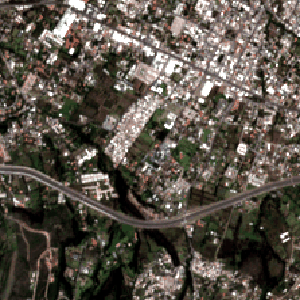
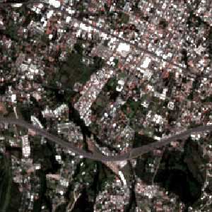

# Urban Expansion Quito

## Study Areas
Nayón, Cumbayá, Tumbaco, Puembo (Pifo excluded)

## Goals
- Sentinel-2 L2A acquisition
- Cloud masking and composites
- NDVI/NDBI analysis
- Historical land-cover and urban expansion
- Future PyTorch CNN investigation

## Status
Phase 1: Annual Sentinel-2 composite acquisition demonstrated for the Tumbaco test AOI. Quality assessment and urban-change validation remain pending.

## Notes
10m resolution limits small parcel detection.

## Sentinel Hub Evalscript methodology and references

The planned Sentinel-2 processing pipeline uses a **custom Evalscript V3** submitted through the Sentinel Hub Process API. The script is project-specific; it is **not** an official prevalidated monthly compositing algorithm.

Evalscript V3 requires `setup()` to define input bands and output format and `evaluatePixel()` to process the selected pixel samples. Our proposed approach uses spectral bands B02, B03, B04, B08, B11, B12, the Scene Classification Layer (SCL), and `dataMask` to create cloud-screened reflectance composites for Python-defined annual, quarterly, or monthly intervals and observation counts. The use of `ORBIT` mosaicking and the resulting temporal aggregation will be checked against source acquisitions before full-scale processing. SWIR bands B11/B12 have native 20 m resolution, even when exported on a 10 m grid.

**Official documentation:**
- [Sentinel Hub Evalscript V3 specification](https://docs.sentinel-hub.com/api/latest/evalscript/v3/) — `setup`, `evaluatePixel`, input/output configuration, mosaicking, and sample types.
- [Copernicus Data Space Evalscript documentation](https://documentation.dataspace.copernicus.eu/APIs/SentinelHub/Evalscript.html) — CDSE-specific usage and processing behavior.
- [Copernicus Evalscript examples](https://documentation.dataspace.copernicus.eu/APIs/SentinelHub/Evalscript/Examples.html) — examples of NDVI, multitemporal calculations, and change detection.

**Validation pending:** cloud/shadow masking, missing-data treatment, valid-observation counts, temporal consistency, and georeferencing. Annual composite examples are documented below; no validated urban-change model outputs are included yet.

## Script organization

The repository separates acquisition methods, spatial mosaicking, and the Sentinel Hub Evalscript:

```text
scripts/
├── data_acquisition/
│   ├── acquisition_common.py
│   ├── download_annual.py
│   ├── download_quarterly.py
│   └── download_monthly.py
├── data_acquisition_fallback/
│   └── download_fallback.py
├── mosaicing/
│   └── mosaic_tiles.py
└── evalscript/
    └── median_composite.js
```

Run scripts from the repository root. Each moved Python module resolves the repository root two directory levels above its file. The primary acquisition engine loads `scripts/evalscript/median_composite.js` and the root `.env`. The fallback uses the separate CDSE S3 credentials documented below. Output raster paths have not changed.

```powershell
python scripts/data_acquisition/download_annual.py
python scripts/data_acquisition/download_quarterly.py
python scripts/data_acquisition/download_monthly.py
python scripts/data_acquisition_fallback/download_fallback.py --year 2025 --max-scenes 12
python scripts/mosaicing/mosaic_tiles.py --frequency annual --year 2025 --expected-tiles 12
```

## Installation and dependencies

Python 3.10 or newer is recommended. Clone the repository and open a terminal in its root directory:

```bash
git clone https://github.com/jayjayanton/Urban-Expansion-Quito.git
cd Urban-Expansion-Quito
python -m venv .venv
```

Activate the virtual environment:

**Windows PowerShell:**
```powershell
.\.venv\Scripts\Activate.ps1
```

**macOS/Linux:**
```bash
source .venv/bin/activate
```

Install the project's Python dependencies:

```bash
python -m pip install --upgrade pip
python -m pip install -r requirements.txt
```

Verify the imports:

```bash
python -c "import numpy, rasterio, dotenv, sentinelhub; print('Dependencies OK')"
```

The `requirements.txt` file includes `numpy`, `rasterio`, `python-dotenv`, and `sentinelhub`. Python's built-in `os` and `pathlib` modules require no separate installation.

### API credentials — primary and fallback are separate

The project uses **two independent authentication mechanisms**. Create a local `.env` file in the repository root with the credentials for the workflow(s) you intend to run:

```dotenv
# PRIMARY: Sentinel Hub Process API (OAuth client credentials)
SH_CLIENT_ID=your_sentinel_hub_client_id
SH_CLIENT_SECRET=your_sentinel_hub_client_secret

# FALLBACK: Copernicus Data Space S3 object storage (S3 access keys)
CDSE_S3_ACCESS_KEY=your_cdse_s3_access_key
CDSE_S3_SECRET_KEY=your_cdse_s3_secret_key
```

| Workflow | Authentication | Environment variables |
|---|---|---|
| `download_annual.py`, `download_quarterly.py`, `download_monthly.py` | Sentinel Hub OAuth | `SH_CLIENT_ID`, `SH_CLIENT_SECRET` |
| `download_fallback.py` | CDSE S3 access keys | `CDSE_S3_ACCESS_KEY`, `CDSE_S3_SECRET_KEY` |

**Do not interchange these credential pairs.** The fallback STAC catalogue search does not require S3 credentials in `--dry-run` mode; downloading JP2 assets from S3 does. If you use only one acquisition method, you only need its corresponding credentials. The fallback does not automatically reuse Sentinel Hub OAuth credentials.

Never commit `.env`, real keys, or secrets. Ensure `.env` is excluded by `.gitignore`; keep large rasters and local ArcGIS Pro workspace files out of version control. Run scripts from the repository root and keep scientific GeoTIFF outputs local.

## Study AOI and spatial processing conventions

The **target common processing AOI** for future comparisons between the Sentinel Hub Process API (primary) and CDSE STAC + S3 (fallback) is the WGS84 longitude/latitude bounding box **west -78.47, south -0.248, east -78.32, north -0.11** (EPSG:4326). Both workflows should project to **EPSG:32717 (UTM zone 17S)** and produce **10 m pixels** on the **same snapped grid**, with matching bounds, transform, dimensions, band order, masking, and temporal windows before quantitative comparisons. The observed fallback run used a **1,672 × 1,528 pixel** grid divided into **3 rows × 4 columns** of up to 512 × 512 pixels. The seven output bands are B02, B03, B04, B08, B11, B12 and valid_count.

**Scope caveat:** The existing Sentinel Hub benchmarks do **not yet use this AOI**: they began with a 5 km × 5 km Tumbaco tile and a four-tile (2 × 2) pilot. The common bounding box is a target for future harmonized runs, not a claim that past benchmark results share the fallback extent. It is also a current processing AOI, **not** a finalized boundary for every planned eastern-valley study area (including Guayllabamba). Confirm the final study footprint before regional conclusions.

### Why fallback outputs spatial tiles

S3 exposes source Sentinel-2 JP2 assets; it does not run this project's cloud-screening, reprojection, annual temporal median, and custom output mosaic on the server. The fallback script therefore performs these steps locally and **intentionally processes the AOI in spatial tiles** to bound memory use, permit per-tile retries, and reuse cached source JP2 bands. Tiling is an implementation choice, not an S3 requirement. The separate `mosaic_tiles.py` joins adjacent processed tiles **spatially** into a continuous annual GeoTIFF; it does not combine dates or recalculate the annual median. The Sentinel Hub Process API instead performs the requested processing remotely and can return an AOI-sized output, subject to service limits. A single local full-AOI output would also be possible, but would reduce the current per-tile restart flexibility.

## Step 1 — Sentinel-2 annual composite examples (2016 vs 2025)

The first reproducible acquisition milestone is to retrieve Sentinel-2 Level-2A observations for a small test AOI near Tumbaco, screen observations using the Scene Classification Layer (SCL), and calculate **per-band annual median surface reflectance** with a custom Sentinel Hub Evalscript. Python saves six reflectance bands (B02, B03, B04, B08, B11, B12) plus a valid-observation-count band in a GeoTIFF.

**Visual comparison (true color: B04/B03/B02):**

| 2016 annual composite | 2025 annual composite |
|:---:|:---:|
|  |  |

The images are display-oriented PNG exports derived from the scientific multiband GeoTIFFs; the original spectral values are retained in local GeoTIFFs for subsequent analysis. Both PNGs use a common RGB stretch for visual comparability. This is an **illustrative before/after comparison**, not yet a validated map of urban expansion. Differences may reflect seasonal sampling, atmosphere, residual cloud contamination, or land-cover change.

**Image assets:** Place `sentinel2_2016_rgb.png` and `sentinel2_2025_rgb.png` in `assets/` for the table above to render on GitHub. Large source GeoTIFFs are intentionally excluded from version control.


## Step 2 — Acquisition frequency benchmark methodology

The project now provides **three separate entrypoints** using one shared acquisition engine and the same cloud-screening/median Evalscript V3. The evalscript was renamed from `scripts/evalscript/monthly_composite.js` to `scripts/evalscript/median_composite.js` because it does **not** select dates. Python defines the temporal interval; the evalscript selects bands B02/B03/B04/B08/B11/B12, filters observations using SCL classes 4/5/6/7 and dataMask, and returns six per-band median reflectances plus a valid orbit-level observation count. It is not an arithmetic average or a single selected acquisition.

### Common benchmark geometry

All three benchmark scripts use the same **5,000 m × 5,000 m square (25 km²)** centered near Tumbaco at longitude -78.41, latitude -0.22. The center is projected to **EPSG:32717** before constructing the exact metric square; the output is **500 × 500 pixels at 10 m**. This controlled tile is intentionally smaller than the broader Quito-valleys study AOI. Change `CENTER_LON_LAT` and `SIDE_METERS` in `scripts/data_acquisition/acquisition_common.py` to adjust the benchmark. Full regional tiling and mosaicking are planned, not yet implemented.

### Run each strategy

From the repository root (after installing `requirements.txt` and configuring local OAuth credentials):

```powershell
python scripts/data_acquisition/download_annual.py
python scripts/data_acquisition/download_quarterly.py
python scripts/data_acquisition/download_monthly.py
```

| Strategy | Temporal request | Requests per year per tile | Output directory |
|---|---|---:|---|
| Annual | January–December | 1 | `data/benchmarks/annual/<year>/` |
| Quarterly | Q1, Q2, Q3, Q4 | 4 | `data/benchmarks/quarterly/<year>/` |
| Monthly | Calendar months | 12 | `data/benchmarks/monthly/<year>/` |

The shared engine currently runs **2016 only** with `YEARS = [2016]`. The full historical loop is preserved as a commented line (`# YEARS = range(2016, 2026)`) in `scripts/data_acquisition/acquisition_common.py`. To run all years after validating the 2016 benchmark, uncomment the full range and comment out the 2016-only line. Each output is saved separately, with the date interval, processing duration, valid-pixel coverage and evalscript SHA-256 in its metadata. Previously completed files are skipped only if the raster geometry and relevant processing metadata match. API throttling or processing limits can still occur, particularly for annual requests.

### Benchmark interpretation and next stages

Compare request success/failure, elapsed processing time, output size, valid coverage, and observation counts across identical AOIs and years. **Monthly/quarterly medians cannot simply be averaged or median-combined to recover the exact annual median of all source observations**. A separate, documented temporal aggregation method will be required for local annual products. Likewise, a future `mosaic_tiles.py` will spatially combine aligned tiles for the wider study area; it is not part of this initial benchmark. No claim of improved efficiency is made until timings and data quality are measured.

For training, align ESA WorldCover 2020/2021 to the Sentinel-2 10 m grid using nearest-neighbor resampling; WorldCover built-up class 50 can provide candidate binary labels, but independent reference checks remain necessary. WorldCover's 2020/2021 maps are not annual labels for the entire 2016–2025 period.


## Step 3 — Spatial tiling and mosaicking (2016 pilot)

The acquisition scripts now process **four adjacent 5 × 5 km tiles** in a 2 × 2 grid, covering **100 km²**. All tiles share the same EPSG:32717 projected 10 m grid. This tests whether smaller API requests are more reliable than a single large annual request. The tile origin is anchored at the original Tumbaco test location; the 2 × 2 pilot extends east and north of the original tile. Configure `GRID_COLS` and `GRID_ROWS` in `scripts/data_acquisition/acquisition_common.py` to change the number of tiles. The default remains **2016 only**.

The three strategies produce four annual, sixteen quarterly, or forty-eight monthly tile files for the pilot. Downloads are stored under `data/benchmarks/<frequency>/2016/`, using a `tile_r##_c##` suffix. Once downloads finish, mosaic each period **spatially**, using the new `scripts/mosaicing/mosaic_tiles.py`:

```powershell
python scripts/data_acquisition/download_annual.py
python scripts/mosaicing/mosaic_tiles.py --frequency annual --year 2016 --period annual

python scripts/data_acquisition/download_quarterly.py
python scripts/mosaicing/mosaic_tiles.py --frequency quarterly --year 2016 --period Q1

python scripts/data_acquisition/download_monthly.py
python scripts/mosaicing/mosaic_tiles.py --frequency monthly --year 2016 --period 01
```

Repeat the mosaic command for Q2–Q4 and months 02–12 as needed. The script requires at least two tiles and verifies band count, resolution, CRS, and band descriptions. **Important:** it currently mosaics whatever matching tiles exist; before treating an output as complete, verify that all four expected tiles were downloaded. It does not yet aggregate monthly or quarterly mosaics into annual rasters. Spatial mosaicking joins neighboring places; temporal aggregation combines different dates for the same place. The annual composite method and monthly/quarterly methods are not mathematically identical.

**Scale considerations:** the standard Sentinel Hub Process API output-size limit is not a total-area allowance. Smaller tiles reduce per-request load but may increase total requests and processing-unit consumption. A national-scale workflow would need quota-aware orchestration and likely batch/cloud processing. Benchmark actual failures and elapsed times before increasing tile dimensions or study extent.


## Step 4 — Fallback acquisition via CDSE STAC and S3 (2025 pilot)

### Motivation and scope

The primary acquisition route is the Sentinel Hub Process API, which executes the project's Evalscript server-side. When that route is unavailable or impractical because of processing-unit limits or service restrictions, `scripts/data_acquisition_fallback/download_fallback.py` provides an independent **annual** acquisition route using the Copernicus Data Space STAC catalogue and authenticated S3 object storage. This is not an automatic retry for invalid credentials or malformed API requests. The fallback does not consume Sentinel Hub processing units, but it downloads large source files and requires local processing.

### Reproducible acquisition method

1. Search the `sentinel-2-l2a` STAC collection for acquisitions intersecting the requested WGS84 bounding box and year. The `--max-cloud` filter uses catalogue scene-wide cloud cover, **not** cloud cover over the study AOI.
2. Optionally use `--max-scenes N` to choose up to N acquisitions distributed across the year, preferring lower cloud cover within temporal windows. Without this option, all matching catalogue scenes are considered; this may be expensive.
3. For each selected acquisition, retrieve B02, B03, B04 and B08 (native 10 m), B11 and B12 (native 20 m), and the Scene Classification Layer SCL (20 m) from S3 as JP2 assets. Source assets are cached by URL-derived hash and reused across output tiles. The default cache is removed after each year unless `--keep-cache` is supplied.
4. Reproject and resample bands onto a common 10 m EPSG:32717 grid. Spectral bands use bilinear interpolation except B11/B12, which use nearest-neighbor; SCL uses nearest-neighbor to preserve categorical values. The script applies a simplified processing-baseline-dependent reflectance offset, which **requires validation against product metadata**.
5. Retain pixels whose SCL class is 4 (vegetation), 5 (non-vegetated), 6 (water), or 7 (unclassified), subject to valid spectral data. Class 7 is not guaranteed cloud-free and should be evaluated during quality assessment. Compute a per-band median across selected valid acquisitions and record `valid_count` as the seventh band. Zero counts denote no usable observation, while missing spectral values are written as -9999.
6. Write tiled GeoTIFFs named `data/<year>/tiles/sentinel2_<year>_r<row>_c<col>.tif`, then combine them spatially with `scripts/mosaicing/mosaic_tiles.py`. Mosaicking does not perform additional temporal aggregation.

### Observed 2025 pilot

The run `python scripts/data_acquisition_fallback/download_fallback.py --year 2025 --max-scenes 12` uses the current script's default bounding box `[-78.47, -0.248, -78.32, -0.11]` and 10 m resolution. The catalogue returned **91 candidate scenes**, of which **12** were selected across 2025. Each acquisition requires seven JP2 assets, giving **84 distinct source files** for the observed single-granule selection, shared by **12 output tiles** in a 3-row × 4-column grid. The projected output extent was **1,672 × 1,528 pixels**. In the observed run, initial downloading and processing of tile r0 c0 took about 28 minutes; subsequent cached tiles completed much faster. These are observed timings, not general performance guarantees. The number of cached files can be higher when multiple source granules are needed.

### Usage

Install dependencies with `python -m pip install -r requirements.txt` and configure `CDSE_S3_ACCESS_KEY` and `CDSE_S3_SECRET_KEY` in the local, untracked `.env` file. These are distinct from Sentinel Hub OAuth credentials.

```powershell
python scripts/data_acquisition_fallback/download_fallback.py --year 2025 --dry-run --max-scenes 12
python scripts/data_acquisition_fallback/download_fallback.py --year 2025 --max-scenes 12
python scripts/mosaicing/mosaic_tiles.py --frequency annual --year 2025 --expected-tiles 12
```

**Important:** Existing output tiles are skipped based on geometry, band count, and CRS, not the selected scene IDs. If `--max-scenes`, selection rules, or processing parameters change, remove or version the affected outputs before rerunning; otherwise stale tiles may be mistaken for current results. The local JP2 cache is reusable only while retained.

### Methodological limitations and validation

The fallback is **not scientifically identical** to Sentinel Hub Evalscript composites: scene sampling, orbit handling, masking, reflectance corrections, resampling, and median aggregation may differ. Compare both methods on a common AOI and dates before combining their outputs. Inspect spatial coverage, the fraction of pixels with `valid_count=0`, cloud/shadow artifacts, and reflectance ranges. A maximum `valid_count=12` only indicates that some pixels had twelve observations; it does not establish complete coverage. The 2025 pilot is an acquisition/compositing milestone, **not** a validated urban classification or change-detection result. Source JP2 files and large GeoTIFFs remain local and should not be committed to GitHub.
