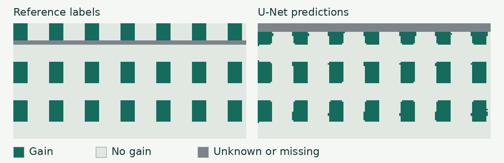

# Detecting built-up gain in Tumbaco with Sentinel-2 and a U-Net

Which pixels near Tumbaco, Ecuador, changed from non-built land in 2016 to built-up land in 2025? The project treats this as **two-date semantic segmentation**. A field converted to a housing development is a positive example. A neighborhood already built up in 2016 is a negative example, even if its roofs are clearly visible in 2025.

**Current evidence.** The two real satellite composites share a 223 × 221 grid. The CNN has been trained and tested end to end on a synthetic image pair. Measuring its accuracy in Tumbaco requires independently reviewed labels for both dates.

## From imagery to a map

| Step | Implementation and rationale |
| --- | --- |
| Pair the inputs | Read blue, green, red, near-infrared and two shortwave-infrared bands for each date. Stack the earlier date first to create 12 input channels. Check band order, CRS, transform and dimensions. Use each date’s observation-count band to exclude pixels without usable imagery. |
| Define the target | Encode confirmed gain as 1, reviewed no gain as 0, and uncertain or unreviewed pixels as 255. Ignore 255 in training and scoring. This lets a reviewer label a few well-documented sites without treating the rest of the valley as negative. |
| Separate locations | Assign western, central and eastern strips to training, validation and testing. Leave an eight-column buffer on each side of each boundary by default. Clip each chip’s surrounding context to its own region. Compute per-band normalization from training geography only, pooling both dates. |
| Learn spatial patterns | A PyTorch U-Net combines the two dates in its first convolution. The encoder learns neighborhood features. The decoder uses skip connections to recover spatial detail. By default, the model sees a 72 × 72 patch and scores its central 32 × 32 pixels. Adam updates the weights using binary cross-entropy on reviewed, usable pixels. |
| Evaluate and export | Choose the epoch and gain threshold using validation F1. Freeze both before scoring the eastern test strip. Report confusion counts, gain precision, recall, F1 and intersection over union (IoU). Write a gain score and a thresholded mask as GeoTIFFs on the original grid. |

[Raster loading and spatial splits](../scripts/vision/data.py) · [U-Net architecture](../scripts/vision/model.py) · [Training, evaluation and inference](../scripts/vision/workflow.py)

## Worked example on synthetic imagery



Both panels show the full invented scene from the PDF tutorial. The gray interior stripe in the reference was left unreviewed. Predictions can still cover it where both dates have valid imagery. The reported metrics use only reviewed, usable pixels in the held-out strip. In the documented run, the model recovered 394 of 396 gain pixels and flagged 14 no-gain pixels as gain. This example exercises the pipeline and illustrates how to interpret its outputs.

To reproduce the exercise from the repository root, install the vision dependencies and choose a new output directory. The demo saves the checkpoint, test report and both GeoTIFFs.

```bash
python -m pip install -r requirements-vision.txt
python -m scripts.vision inspect
python -m scripts.vision.demo data/cv/methods-demo
```

[Illustrated PDF tutorial](Quito_Sentinel2_Change_Detection_Tutorial.pdf) · [Synthetic experiment](../scripts/vision/demo.py) · [Model regression tests](../tests/test_vision.py)

## First Quito validation experiment

1. Check persistent roads and large roofs across both dates for misregistration. Compare clouds, shadows and bare soil where apparent change is ambiguous.
2. Use dated independent imagery or records to review gain and no-gain sites in each region. Record source dates, reviewer and confidence. Include stable roofs and bare fields as negatives. Leave mixed edges unknown. Page 3 of the tutorial shows how to burn those polygons into an aligned mask.
3. Fit the CNN and a pixel-based baseline such as XGBoost using the same labeled sites, input bands and geographic splits. Compare held-out precision, recall and IoU. Inspect false positives over bare soil and missed development along built-up edges.
4. Publish the label provenance, site and pixel counts per split, confusion counts and dated examples of errors. A further test in a separately labeled valley would measure geographic transfer beyond the pilot.
